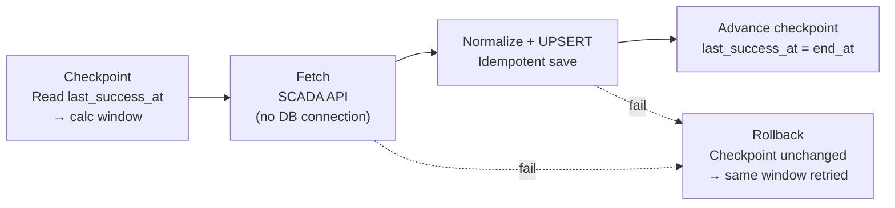

## Polling Window

The poller retrieves sensor data using 10-minute aligned, half-open time windows.



### Initial Polling

If no successful checkpoint exists, retrieve the latest one-hour window.

**Example:** Current time = `10:23`

```text
start_at = 09:20
end_at   = 10:20

Window: [09:20, 10:20)
```

### Normal Polling

Start from the last successful checkpoint.

**Example:** Last successful end = `10:10`

```text
start_at = 10:10
end_at   = 10:20

Window: [10:10, 10:20)
```

### Long Outages

Split the missing time range into sequential requests, each limited by `MAX_WINDOW`.

**Example:** Last checkpoint = `09:00`, Current time = `12:23`, `MAX_WINDOW = 1 hour`

```text
Request 1: [09:00, 10:00)
Request 2: [10:00, 11:00)
Request 3: [11:00, 12:00)
```

Continue until the latest available interval is reached.

## Data Normalization

Vendor-specific adapters convert SCADA API responses into a common internal format.

| External field 1 | External field 2 | Internal Canonical field |
|---|---|---|
| `turbine_code`    | `asset_id`        | `turbine_id`      |
| `timestamp`       | `recorded_at`     | `measured_at`     |
| `wind_speed`      | `wind_velocity`   | `wind_speed_ms`   |
| `active_power`    | `power_kw`        | `power_output_kw` |
| `rotor_speed`     | `rotor_rpm`       | `rotor_speed_rpm` |

## Strategy Pattern
```python
# 1. Define individual strategies (algorithms)
def normalize_siemens(raw):
    # Siemens-specific parsing logic...
def normalize_vestas(raw):
    # Vestas-specific parsing logic...

ADAPTERS = {
    "siemens": normalize_siemens,
    "vestas": normalize_vestas,
}

# 2. Context function uses the chosen strategy dynamically
def normalize_payload(provider: str, payload: dict):
    adapter = ADAPTERS.get(provider)
    normalized_data = adapter(payload)
```