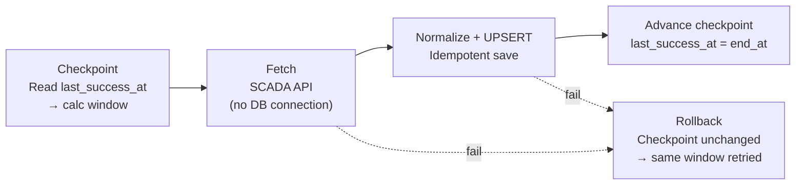

## Polling Window

The poller retrieves sensor data using 10-minute aligned, half-open time windows.



### Initial Polling

If no successful checkpoint exists, retrieve the latest one-hour window.

**Example:** Current time = `10:23`

```text
start_at = 09:20
end_at   = 10:20

Window: [09:20, 10:20)
```

### Normal Polling

Start from the last successful checkpoint.

**Example:** Last successful end = `10:10`

```text
start_at = 10:10
end_at   = 10:20

Window: [10:10, 10:20)
```

### Long Outages

Split the missing time range into sequential requests, each limited by `MAX_WINDOW`.

**Example:** Last checkpoint = `09:00`, Current time = `12:23`, `MAX_WINDOW = 1 hour`

```text
Request 1: [09:00, 10:00)
Request 2: [10:00, 11:00)
Request 3: [11:00, 12:00)
```

Continue until the latest available interval is reached.

## Data Normalization

Vendor-specific adapters convert SCADA API responses into a common internal format.

| External field 1 | External field 2 | Internal Canonical field |
|---|---|---|
| `turbine_code`    | `asset_id`        | `turbine_id`      |
| `timestamp`       | `recorded_at`     | `measured_at`     |
| `wind_speed`      | `wind_velocity`   | `wind_speed_ms`   |
| `active_power`    | `power_kw`        | `power_output_kw` |
| `rotor_speed`     | `rotor_rpm`       | `rotor_speed_rpm` |

## Strategy Pattern
```python
# 1. Define individual strategies (algorithms)
def normalize_siemens(raw):
    # Siemens-specific parsing logic...
def normalize_vestas(raw):
    # Vestas-specific parsing logic...

ADAPTERS = {
    "siemens": normalize_siemens,
    "vestas": normalize_vestas,
}

# 2. Context function uses the chosen strategy dynamically
def normalize_payload(provider: str, payload: dict):
    adapter = ADAPTERS.get(provider)
    normalized_data = adapter(payload)
```

## Concurrency Control by Level

Concurrency can be controlled at different levels depending on the scope of the work.

| Level | Mechanism | Scope | Purpose |
|---|---|---|---|
| Job execution | APScheduler `max_instances` | Single scheduler process | Prevent overlapping executions of the same scheduled job |
| Data source | PostgreSQL Advisory Lock | Multiple worker processes | Prevent concurrent polling of the same data source |
| Database transaction | PostgreSQL transactions | Database operations | Maintain data consistency and atomicity |
| Distributed messaging | Kafka consumer groups | Multiple consumers | Distribute message processing across consumers |


## Distributed Polling Lock

### Implementation

* Uses PostgreSQL Advisory Locks (`pg_try_advisory_lock`).

* Each data source has a deterministic lock key derived from its UUID.

* If another worker already holds the lock, the worker skips that data source instead of waiting.

* PostgreSQL automatically releases `session-level advisory locks` when the owning database connection closes.

### Worker Coordination

When two workers attempt to poll the same data source:

1. Worker A acquires the lock and starts polling.

2. Worker B fails to acquire the lock and skips that data source.

3. Worker A completes polling and releases the lock.

4. A subsequent polling attempt can acquire the lock.


## Race Condition: Kafka publish vs. DB commit

The poller published to Kafka *before* committing `RUNNING → PUBLISHED`.
The consumer could receive the message while the run was still `RUNNING`,
so its `PUBLISHED → PROCESSING` transition failed and fell back to retries.

```
Poller                               Consumer
publish to Kafka ──────────────────► receives message
(DB still RUNNING)                   RUNNING → PROCESSING fails
commit PUBLISHED                     transient retry...
```

### Fix
The checkpoint advances only after a successful publish.

```
Poller:   RUNNING → PUBLISHED   (Kafka publish after DB commit)
          RUNNING/PUBLISHED → FAILED (polling or publish failure)
Consumer: PUBLISHED → PROCESSING → SUCCESS
                                  ↘ FAILED
```

## Kafka Reliability Tests

- **Consumer crash during processing:** If the consumer crashes while a run is `PROCESSING`, the Kafka offset remains uncommitted. When the message is redelivered, `process_message()` detects `PROCESSING` and reprocesses the run.

- **Duplicate message:** If a message is delivered again for a run already in `SUCCESS` or `FAILED`, `process_message()` skips processing and commits the offset.

- **Kafka publish failure:** If Kafka publishing fails, the poller marks the ingestion run as `FAILED` and records the error in the checkpoint. `last_success_at` remains unchanged, allowing the polling window to be retried.

- **Duplicate data:** `save_readings()` uses database upsert with `(turbine_id, measured_at)` as the unique key, preventing duplicate rows when readings are reprocessed.
